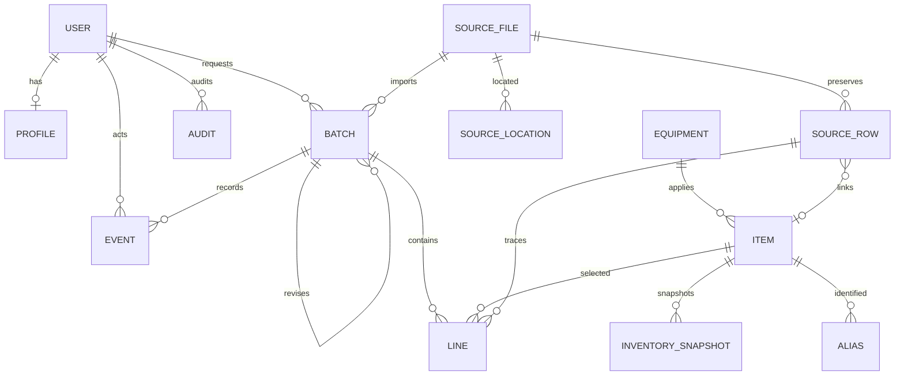

# V1.0 数据库设计

本阶段在现有 develop 基础架构上导入用户提供的候选源码，重构后端所属 App。
任务包中的历史验收结论仅作为参考，不作为本次执行结果。原始 source 文件未包含。

## 用户与 App 边界

继续使用 Django auth.User，不替换已迁移的用户表；密码由 Django 哈希保存。
accounts.Profile 一对一扩展角色（requester/reviewer/admin）及部门，Django Group/
Permission 保留模型级授权能力，业务服务执行归属人、部门、状态的对象级权限。
accounts.Audit 保存操作前后快照。reports 读取业务模型，无重复业务数据表。

| App | 模型 | 主键 / 关系 | 用途及数据库约束 |
| --- | --- | --- | --- |
| accounts | Profile | 自增 ID；user 唯一 FK | 三种业务角色，禁止非法角色 |
| accounts | Audit | 自增 ID；actor 可空受保护 FK | 操作对象、动作、JSON 前后快照、时间 |
| inventory | Equipment | UUID；唯一内部 code | 名称、型号、品牌、位置、启用状态；设备代码不等于料号 |
| inventory | Item | UUID；equipment_record 可空 FK | 新旧料号不唯一；独立保留重复码和待确认物料 |
| inventory | Alias | 自增 ID；item、source_row FK | 新/旧/候选编码，verified 控制人工核验匹配 |
| inventory | SourceFile | 自增 ID；actor FK | SHA-256 唯一、原文件名、独立私有原件、导入类型 |
| inventory | SourceLocation | 自增 ID；source FK | 文件+来源路径唯一，同内容可多路径 |
| inventory | SourceRow | 自增 ID；source、item FK | 文件+sheet+row 唯一；原值、表头、公式缓存、映射、异常、年月候选 |
| inventory | InventorySnapshot | 自增 ID；item、source_row FK | 月份、仓库、单位、库存、未交和采集时间；同物料年月仓库单位唯一 |
| requests | Batch | 自增 ID；requester、source、parent FK；family UUID | 月度申请，年份2000–2100、月份1–12；状态与类型检查 |
| requests | Line | 自增 ID；batch、item、source_row、equipment_record FK | 21列字段快照；数量 Decimal(20,6)，非负，原数量与单位独立 |
| approvals | Event | 自增 ID；batch、actor 受保护 FK | 审批/退回/修改记录，前后状态、行快照、意见和时间 |

## 主单与版本

Batch.kind 区分备件购买/部门自购；status 为 draft/submitted/approved/returned。
version 表示业务修订序号，lock_version 表示并发修改次数，family 标识同一业务族。
同 family+version 唯一；同 family 仅一个 effective=True，且生效必须已批准。
同源文件+工作表仅一份原始导入单；不同字节的同名版本保留，人工选择生效。
不强制一人一月一单，管理员可确认哪些历史单据属于同一族，不能猜测合并。
父单保留不覆盖；复制到新月清除库存/未交/实际等快照。创建、修改、审批、
生效选择在事务内记录审计，通过行锁、乐观版本校验和 PostgreSQL advisory lock
保护并发导入与版本分配。提交和审核时间单独保存。

## 21列明细

稳定字段以 DATA_CONTRACT.md 为准。文本业务字段保存为独立列并保留 values
源快照；quantity 对应 forecast_qty，避免两个可独立更新的预测数量列。
其它数值字段各用 Decimal(20,6)，空白/占位/错误不得自动变为零。
raw_quantity 永久保留当次原文；unit 是独立字段。只有人工确认数量和单位
的生效批准单进入汇总，分组包含单位，绝不把 m 与 个相加。
文本字段在保存时从 values 同步；原始单元格、原表头及缓存位于 SourceRow，
不因业务改稿丢失。设备外键和原 equipment_name 并存，未知名称不自动建档。

## 导入与追溯

流程为 scan预览 → ingest保存不可变原件和所有非空源行 → apply_catalog /
confirm_sheet人工确认。SHA-256 幂等通过事务级锁保护；重复文件增加来源路径，
不增加申请量。原件保存到私有 MEDIA_ROOT，以哈希生成存储文件名。
主资料按中文表头识别；支持21/17/18列历史申请，5列费用表与领用记录仅存证。
18列双库存/未交必须显式选列。每个不支持、错误、缺失和待确认行都有状态与原因。
月度来自人工确认，候选文件/目录/表头年月保留，不能按文件名自动修正。
不得覆盖、修改或向公共仓库提交 source/ 原件。

## 迁移策略

现有 auth/admin/session 迁移和 apps.core 健康接口保持可用。
候选源码 core 的旧迁移没有在本仓库执行，因此不复制它们；为拆分后的
accounts/inventory/requests/approvals 生成真实初始迁移。循环来源 FK 由 Django
分阶段迁移解决。reports 无表，不需要制造空迁移。
上线顺序：备份现有数据库 → migrate → check → PostgreSQL 自动化测试。
禁止改用 SQLite 验证数据库锁与约束。

## 关系图

